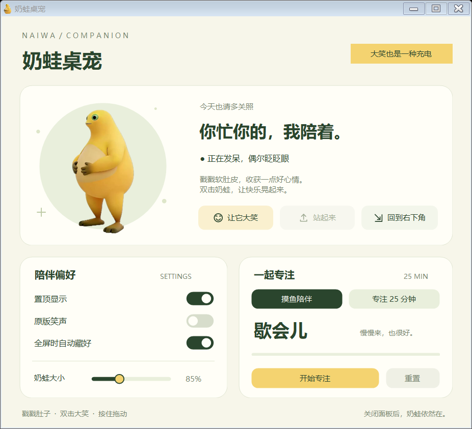

# 奶蛙桌宠

**1.3.3 · Windows 10 / 11 x64 · 本地运行 · 非商业衍生版**

把奶蛙放在桌面上，摸摸肚子、拖着走，或双击看它捧腹大笑。新增陪伴面板与 25 分钟专注计时，常用设置也可以在面板里调整。

本项目基于 [yugh6/Naiwa](https://github.com/yugh6/Naiwa) 的源码与原始素材制作，上游作者为 **yugh6（抖音：握石竹）**。保留上游署名、形象、动画、原版笑声及许可证；不将它们声称为本项目原创。




## 直接使用

1. 将 `Naiwa-Windows-x64.zip` 完整解压。
2. 打开里面的 `Naiwa` 文件夹，双击 `奶蛙桌宠.exe`。
3. 右键奶蛙，打开「陪伴面板 / 专注计时」，或调整声音、大小等选项。

GitHub 的 [Actions 构建页](https://github.com/Even-Ma/naiwa/actions/workflows/build.yml) 会提供便携压缩包：打开成功的构建，在 Artifacts 中下载 `Naiwa-Windows-x64`，再解压其中的程序包。完整本地项目也可以双击根目录 `run.cmd` 启动。

程序、`素材.nwp` 和 `原版笑声.wav` 需要一直放在同一个文件夹。无需账号、联网或管理员权限。系统需要 .NET Framework 4.5 或更新版本，Windows 10 / 11 通常已具备。

关闭陪伴面板后，奶蛙会继续留在桌面。要完全结束程序，右键奶蛙或任务栏托盘图标，选择「退出奶蛙」。

## 可以怎样互动

| 操作 | 奶蛙的反应 |
| --- | --- |
| 待机 | 自然眨眼。 |
| 鼠标移到身上 | 眼睛跟随注视方向。 |
| 单击肚子 | 肚子凹下，再回弹。 |
| 按住左键拖动 | 跟着移动，轻微倾斜，松手后轻弹。 |
| 双击 | 播放原版捧腹大笑，最后笑倒。 |
| 笑倒后单击 | 恢复站立；也可以双击继续笑。 |
| 右键 | 打开陪伴面板、原有互动与设置菜单。 |
| 双击托盘图标 | 显示或恢复陪伴面板，奶蛙位置不变。 |
| 所在屏幕的前台应用全屏 | 默认暂时隐藏；退出全屏后回来。 |

大笑期间再次双击不会叠加播放。拖动、手动停止或全屏隐藏，会停止当前笑声。笑声首次启动默认关闭，可在右键菜单或面板中开启。

## 陪伴面板与专注

通过右键菜单的「打开陪伴面板 / 专注计时」或双击任务栏托盘图标打开面板；已打开时会恢复显示，奶蛙的位置不变。也可以用 `奶蛙桌宠.exe --panel` 直接打开。

面板提供「摸鱼 / 专注」模式与 25 分钟专注计时，支持开始、暂停、继续、重置和完成后再来一轮。关闭面板后计时继续，到期通过托盘提醒；切回「摸鱼」会暂停当前进度，回来可以继续。退出奶蛙会结束本次计时。

面板中可以实时预览原版动作，让奶蛙大笑、站起来或回到右下角；三个快捷按钮采用无描边样式，保留图标底色以及悬停、按下和状态反馈。也可以调整 50%～150% 大小，以及声音、置顶和全屏自动隐藏开关。大小滑杆支持键盘方向键。

找不到奶蛙时，可以双击任务栏托盘中的奶蛙图标显示或恢复陪伴面板，再选择「回到右下角」；也可以在奶蛙或托盘的右键菜单中选择「回到屏幕右下角」。再次运行程序仍会将奶蛙带回鼠标所在屏幕的右下角。托盘图标可能收在任务栏的小箭头里。若仍在全屏，请先退出全屏，或通过托盘右键菜单关闭「全屏时自动隐藏」。

## 设置与本地数据

程序不会自动开机启动，没有自动更新和遥测。设置只保存到本机：

```text
%LOCALAPPDATA%\NaiwaCompanion\settings.ini
```

将此路径粘贴到资源管理器地址栏即可找到它。退出程序后删除该文件，可恢复默认位置、大小和开关设置。启动异常时，同一文件夹中可能生成 `error.log`，供排查问题。

## 从源码构建

在 Windows 10 / 11 上双击根目录的 **`build.cmd`** 即可。脚本使用 Windows 自带的 .NET Framework C# 编译器，不需要安装 .NET SDK，也不下载 NuGet 包。

GitHub 中保存文本源码和素材来源记录；首次从 GitHub 下载源码构建时，脚本会联网从固定上游提交获取三个素材文件，并校验 SHA-256。已存在且校验通过的素材会直接复用。完整本地源码包已附带素材，可以离线构建；生成后的桌宠始终离线运行。

开发者也可以在项目目录中运行：

```powershell
# 编译并生成便携压缩包
powershell -NoProfile -ExecutionPolicy Bypass -File .\scripts\build.ps1

# 编译、执行自测并打包
powershell -NoProfile -ExecutionPolicy Bypass -File .\scripts\build.ps1 -SelfTest
```

输出位置：

| 路径 | 内容 |
| --- | --- |
| `dist/Naiwa/` | 可直接运行的完整程序文件夹。 |
| `dist/Naiwa-Windows-x64.zip` | 可以分享的便携压缩包，包含许可与来源说明。 |
| `work/self-test/` | 使用 `-SelfTest` 后的测试报告和渲染预览。 |

自测会检查素材、动作、窗口交互、陪伴功能与资源释放；通过后报告末尾为 `RESULT: PASS`。这是程序自带的检查，不能替代不同 Windows 设备上的手动体验。

项目也提供 `Naiwa.csproj`，方便在支持 .NET Framework 的开发环境中打开源码。正式打包请使用上述脚本，以确保素材和许可文件齐全。

## 项目结构

```text
src/                     桌宠、陪伴面板及自测源码
assets/                  上游动作素材、笑声和程序图标
scripts/build.ps1        Windows 构建、可选自测与打包
scripts/fetch-assets.ps1 固定上游版本素材下载与 SHA-256 校验
docs/ASSET_SOURCES.md    素材固定来源及 SHA-256 清单
docs/upstream/           保留的上游说明与预览
docs/PUBLISHING.md       上传到个人 GitHub 的步骤
.github/workflows/       GitHub 上自动构建与检查
LICENSE                  上游 PolyForm Noncommercial 1.0.0 许可原文
THIRD_PARTY_NOTICES.md    上游署名及第三方权利说明
```

## 来源、许可与分享

基于上游固定提交 [`72c763fe1349fb08a06f976e1709f4f5f80e09c7`](https://github.com/yugh6/Naiwa/tree/72c763fe1349fb08a06f976e1709f4f5f80e09c7)。收集日期为 2026-10-24。素材来源见 [素材清单](docs/ASSET_SOURCES.md)，原始说明见 [上游 README](docs/upstream/README.md)。

上游采用 [PolyForm Noncommercial License 1.0.0](LICENSE)。使用、修改和分发应遵守非商业目的和通知等许可条件，并保留 [第三方来源说明](THIRD_PARTY_NOTICES.md)。原角色、图片、视频和声音的独立权利并未由本项目额外授予。

分享请注明作者与 [原项目地址](https://github.com/yugh6/Naiwa)，禁止搬运冒充原创。上游要求短视频公开发布等用途先联系作者取得许可。本衍生版源码仓库为 [Even-Ma/naiwa](https://github.com/Even-Ma/naiwa)，后续构建与维护步骤见 [GitHub 指南](docs/PUBLISHING.md)。
